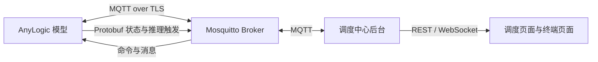

# AnyLogic MQTT 使用说明

本文按实际运行顺序说明 AnyLogic 与调度中心之间的 MQTT 链路。AnyLogic 使用一条
Paho `MqttAsyncClient` 连接，同时承载现场状态、调度命令、推理、生产事件和终端消息。

`fusion_openpit_mine.original.alp` 是只读基线和代码核对材料。请在 AnyLogic IDE 中
打开你实际运行的模型工程；不要直接编辑仓库里的基线文件。下文提到的功能指南是针对
模型副本的分步修改/核对说明，并非每次启动都要重新粘贴代码。

## 链路概览



AnyLogic 在模型启动时调用 `startFieldMqtt()`，连接 Broker；连接成功以及自动重连后，
订阅对应 `simulationId` 的命令主题。后台使用自己的 MQTT 客户端接收状态/回执、计算推理、
发布命令。仿真运行仍由用户在 AnyLogic 中点击 Run 开始。

## 连接配置

| 配置项 | AnyLogic 当前约定 |
| --- | --- |
| Broker | `ssl://localhost:8883`（`fieldBrokerUri`） |
| 用户名 | `field_uplink` |
| 密码环境变量 | `FIELD_MQTT_PASSWORD` |
| TLS 信任 | JVM truststore；工作区演示脚本使用 `mqtt-tls/mqtt-truststore.p12` |
| Client ID | `anylogic-{fieldSimId}` |
| Simulation ID | 模型变量 `fieldSimId`，默认值为 `SIM_001`，须与后台 Run 一致 |
| 会话 | Paho 自动重连、clean session、最大 inflight 1000 |

演示优先使用工作区根目录的一键脚本：

```bash
cd /home/jinx/System1
./demo.sh
```

脚本按需启动/复用 Broker 和后台，并在新启动 AnyLogic GUI 时设置 `FIELD_MQTT_PASSWORD`
及 TLS truststore。脚本不会自动点击 Run。已有 AnyLogic GUI 会被复用，但进程启动后无法
由脚本补设环境变量；若日志出现认证失败，请关闭旧 GUI 后重新运行脚本。

单独启动 AnyLogic 时，先在启动 GUI 的同一终端设置环境变量和 truststore，再运行
`anylogic`。密码应从安全配置或交互提示读取，不要写入模型源码、命令历史或文档。后台使用
`MQTT_PASSWORD`，AnyLogic 使用 `FIELD_MQTT_PASSWORD`；两者应是 Broker 上同一账号的密码。
证书/账号配置见工作区 `mqtt-tls/` 与 `dispatch-center/dispatch-center.env`，不要把其中的
密码复制到说明或提交到版本控制。

## 主题与方向

所有主题都以 `mine/sim/{simulationId}/` 开始。下表中的 QoS/保留标记描述项目约定。

| 方向 | 主题 | 载荷 | 用途 |
| --- | --- | --- | --- |
| AnyLogic → 后台 | `state/map` | Protobuf `MapState`，QoS 1，retained | 道路节点/路段地图；重连后重新发布 |
| AnyLogic → 后台 | `state/vehicle/{vehicleId}` | Protobuf `VehicleState`，QoS 0，非 retained | 车辆位置、速度、任务与状态 |
| AnyLogic → 后台 | `state/shovel/{shovelId}` | Protobuf `ShovelState`，QoS 0，非 retained | 铲装点状态、队列与产能 |
| AnyLogic → 后台 | `trigger/dispatch` | Protobuf `DispatchRequest`，QoS 1 | 卸载后请求后台自动派单 |
| AnyLogic → 后台 | `trigger/speed` | Protobuf `ObservationDict`，QoS 1 | 周期性请求速度推理 |
| 后台 → AnyLogic | `command/manual-dispatch/{commandId}` | JSON，QoS 1 | 人工改派 |
| 后台 → AnyLogic | `command/auto-dispatch/{commandId}` | JSON，QoS 1 | 后台校验后的自动派单结果，按 `requestId` 关联请求 |
| 后台 → AnyLogic | `command/speed/{commandId}` | JSON，QoS 1 | 速度控制指令 |
| AnyLogic → 后台 | `result/manual-dispatch/{commandId}` | JSON，QoS 1 | 人工改派执行结果 |
| AnyLogic → 后台 | `result/decision/{commandId}` | JSON，QoS 1 | 自动派单/速度指令执行回执 |
| AnyLogic → 后台 | `event/production/{vehicleId}` | JSON，QoS 1，非 retained | 运输作业事件；须配置真实 `productionRunId` |
| 后台 → AnyLogic | `terminal/{VEHICLE\|SHOVEL}/{id}/message` | JSON，QoS 1，非 retained | 调度台发往车辆/铲端的消息 |
| AnyLogic → 后台 | `terminal/{VEHICLE\|SHOVEL}/{id}/response` | JSON，QoS 1，非 retained | AnyLogic 自动接收回执；终端人工回复也由后台回流 |

四类命令订阅在 `connectComplete` 中注册，并在 Paho 重连后再次注册：人工改派、自动派单、
速度指令和终端消息。状态数据以 Protobuf 二进制发布；命令、结果及生产/终端事件使用 UTF-8
JSON。`sequence` 是仿真实例级递增序号，不是每辆车各自递增。

## 消息处理边界

Paho 的 `messageArrived` 运行在 MQTT 工作线程，不能在其中读写车辆、铲装点或其他 AnyLogic
仿真对象：

- 自动派单结果只写入并发 Map，由发起派单的仿真逻辑按 `requestId` 取回。
- 人工改派、速度命令和终端消息放入 `manualDispatchQueue`，由循环仿真事件调用
  `processManualDispatchQueue()`，在仿真线程校验并应用。
- AnyLogic 在实际应用指令后发布执行回执。Broker 接受消息不等于车辆已经应用指令。
- 终端消息中的 `AnyLogic AUTO_ACK` 只表示模型已接收，不代表司机/铲端人员确认或完成处理。
- 生产事件使用独立待发送队列，重试时保留原事件 ID 和内容；MQTT PUBACK 仅表示 Broker
  接收，不是后台持久化确认。

## 推荐启动与验收

1. 在工作区根目录运行 `./demo.sh`。确认后台健康接口显示 `mqttConnected: true`。
2. 如无活动 Run，在调度页面创建/开始演示 Run。
3. 在 AnyLogic 中打开已配置的模型，确认 `fieldSimId` 与 Run 的 `simulationId` 一致，点击 Run。
4. 查看 AnyLogic Console 中的 `[FieldMQTT] connected` 和
   `[DecisionGateway] command subscriptions ready`；后台健康页确认连接状态。
5. 按要验收的功能执行相应指南中的链路检查。运行结束后使用 `./stop-demo.sh`；它不会关闭
   AnyLogic GUI，也不会结束 AnyLogic Run。

状态发布周期为 0.5 仿真秒；速度触发也是 0.5 仿真秒。模型基础时间单位虽然是 Minute，
现场消息仍显式使用 `time(SECOND)`。建议现场演示采用 real time / 1×，否则仿真时间与墙钟
速度不同。

## 功能指南

按需要阅读对应说明；状态上报是基础链路，其余是可单独验收的功能：

- [人工改派接入](ANYLOGIC_MANUAL_DISPATCH.md)：队列、安全节点应用与结果回执。
- [自动派单与速度控制](ANYLOGIC_INFERENCE_GATEWAY.md)：Protobuf 触发、后台指令校验、执行回执。
- [双向终端消息协议](TERMINAL_MQTT_CONVERSATION.md) 与
  [AnyLogic 终端消息修改步骤](ANYLOGIC_TERMINAL_MQTT_MANUAL.md)：消息订阅、自动接收回执及联调。
- [生产事件契约与接入点](ANYLOGIC_PRODUCTION_EVENTS.md) 与
  [生产事件代码](ANYLOGIC_PRODUCTION_EVENT_CODE.md)：Run/cycle 关联和可重试 outbox。
- [现场验收步骤](DEMO_ACCEPTANCE.md)：调度、车辆、铲端及推理的端到端检查。

## 常见故障

| 现象 | 优先检查 |
| --- | --- |
| AnyLogic 没有 `[FieldMQTT] connected` | Broker 8883、TLS truststore、`FIELD_MQTT_PASSWORD`、`fieldBrokerUri` |
| 后台显示 MQTT 未连接 | 后台 `MQTT_PASSWORD`、`MQTT_CA_FILE`、Broker 日志；AnyLogic 和后台账号密码应匹配 |
| 页面没有当前状态 | 是否点击 Run、`fieldSimId` 是否匹配、模型的状态发布事件是否运行 |
| 有连接但命令没有执行 | 重连后订阅日志、`manualDispatchQueue` 循环事件、AnyLogic Console 中对应处理错误 |
| 终端消息停在 `SENT` | `terminal/.../message` 订阅及仿真线程处理；核对自动回执和后台 `DELIVERED`，不要把 `SENT` 当作已送达 |

后台 MQTT Broker 仅监听本机 `127.0.0.1:8883`；远程 AnyLogic 主机不能直接连该监听地址，
需要部署可达的 TLS Broker 并同步更新 Broker URI、证书信任和账号权限。